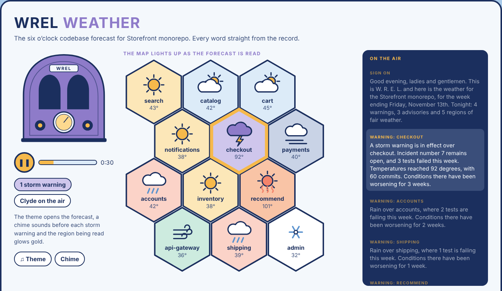

# WREL Weather

**And now, the weather. A storm warning is in effect over checkout.**

The six o'clock codebase forecast: the [Codebase Weather Report](https://github.com/j-m-o/codebase-weather-report) read on the air by a 1940s radio announcer from [Release Radio](https://github.com/j-m-o/release-radio), while the map lights up the region he is talking about.

[](https://github.com/j-m-o/wrel-weather/actions/workflows/ci.yml)

<p align="center">
  
</p>

## Why this exists

A weather map is a good way to show where the risk is in a codebase. A man in a good suit announcing that a storm warning is in effect over checkout is a good way to make a room remember it.

This is a combination of two singles in the same series. The [Codebase Weather Report](https://github.com/j-m-o/codebase-weather-report) decides the weather by fixed rules over real evidence. WREL Weather only puts it on the air. It reads the report's `report.json`, never recomputes a condition and never adds a fact. The announcer is charming. He is still not allowed to improvise.

## Run the demo

Node 20 or newer. No dependencies at runtime, no network.

```bash
node skills/wrel-weather/scripts/cli.js demo --out wrel
```

Open `wrel/player.html` and press play. Without a recorded read, the [WREL theme](https://github.com/j-m-o/release-radio) plays and your browser's own voice reads the forecast. A pre-rendered copy is in [`docs/demo/`](docs/demo/): the [broadcast](docs/demo/broadcast.mp3) with Clyde on the air, the [script](docs/demo/script.md) and the [player](docs/demo/player.html).

## On your own codebase

```bash
# 1. The weather (see the Codebase Weather Report for gathering the data)
codebase-weather forecast --data weather-data --out weather

# 2. On the air
node skills/wrel-weather/scripts/cli.js broadcast --report weather/report.json --out wrel
```

## A real announcer

The demo broadcast uses Clyde, the vintage male radio announcer in the [ElevenLabs](https://elevenlabs.io) voice library.

1. Generate `wrel/script.txt` as a single read. It is one paragraph per segment.
2. Save it as WAV (any rate, mono or stereo).
3. Run the broadcast again with it:

```bash
node skills/wrel-weather/scripts/cli.js broadcast --report weather/report.json --out wrel --voice-file clyde_read.wav
```

The mixer splits the read at the pauses between paragraphs, choosing the split that best fits each paragraph's length (announcers take dramatic pauses mid-paragraph), and checks every piece against its word count, so a bad split fails loudly instead of putting the wrong words under a caption. Then the WREL theme opens and fades under the sign on, the voice goes through an old valve radio with light crackle, a chime sounds before each storm warning and the theme comes back to play the show out.

## The running order

| Segment | What is said |
| --- | --- |
| Sign on | The codebase, the week and the counts of warnings, advisories and fair regions |
| Warnings, worst first | Thunderstorms, rain and heat waves, one region at a time, with the readings and the trend |
| Advisories | Fog, deep freezes and gusty winds |
| Fair weather | Every sunny and partly cloudy region together |
| Sign off | Any source the report had no reading for, then good night |

The full rules are in [`references/script.md`](skills/wrel-weather/references/script.md).

## Reading it live

`script.md` is a cue sheet with theme and chime cues, and the player has a theme button and a chime button, so a speaker can be the announcer in the room while the map lights up.

## What's in the box

| Path | What it is |
| --- | --- |
| `src/forecast.ts` | The script writer and the report contract |
| `src/audio.ts` | The broadcast mixer: WAV in and out, the one-read splitter, the valve radio, the chime and the theme |
| `src/player.ts` | The offline player: the radio, the live map, the captions and The Record |
| `src/icons.ts` | The weather icons, shared with the Codebase Weather Report |
| `src/cli.ts` | The command line |
| `test/` | 19 tests: the running order, the facts, the map lighting, the splitter, the mix and the player |

TypeScript with no runtime dependencies, like the Codebase Weather Report. The mixer is a TypeScript port of Release Radio's Python one, so the series sounds the same in both languages.

## Roadmap

- **v1.1** A weekly forecast posted to [Slack](https://slack.com) with the broadcast attached.
- **v1.2** The ElevenLabs API as an option, so the voice is generated in the same run.
- **v2** A PR forecast: a short bulletin for the regions one pull request touches.

## Related

- [Codebase Weather Report](https://github.com/j-m-o/codebase-weather-report): the weather map this broadcast reads.
- [Release Radio](https://github.com/j-m-o/release-radio): your release report as a 1940s radio broadcast.
- [Quality Tea Leaves](https://github.com/j-m-o/quality-tea-leaves) and [Bug Bestiary](https://github.com/j-m-o/bug-bestiary): the rest of the series.

## License

Copyright (c) 2026 Jessica Mosley. All rights reserved. See [NOTICE.md](NOTICE.md).

Created by Jessica Mosley | [LinkedIn](https://www.linkedin.com/in/jessmosley/) | [GitHub](https://github.com/j-m-o/)
